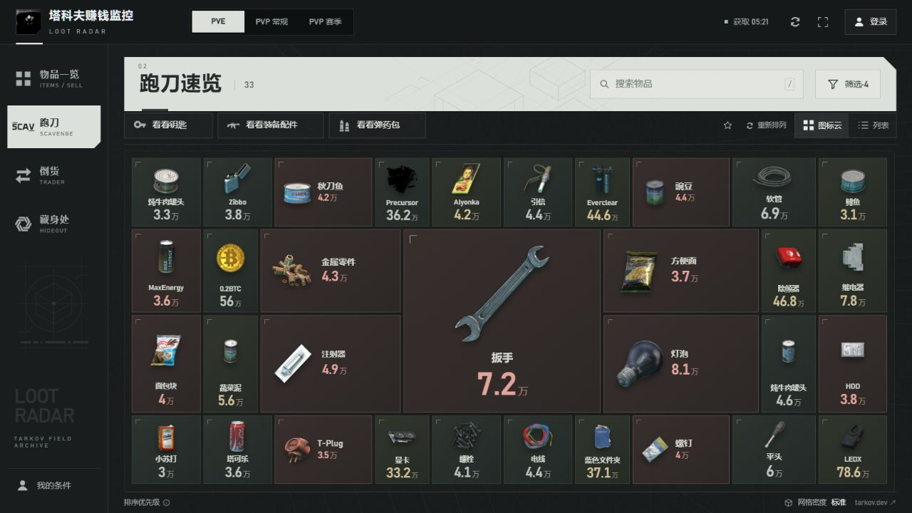
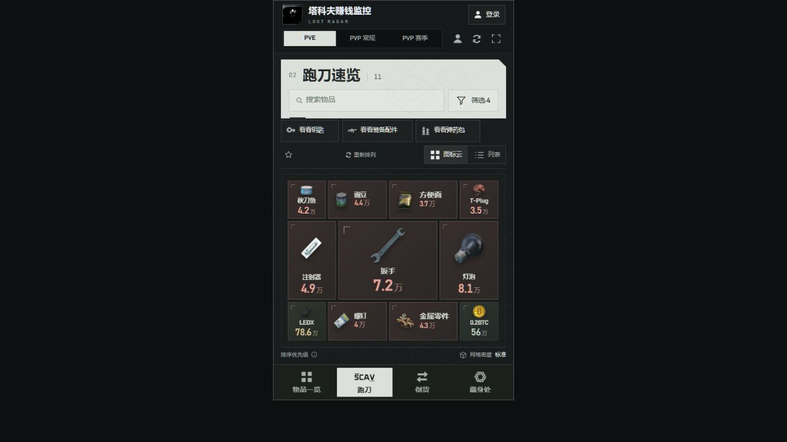

# 前端设计交接

本项目已有真实行情、收益计算、账号、评论和后台。本轮已重做全站视觉、UI 与动效，原有功能、信息层级和已确认的业务行为保持不变。当前源码包含尚未上线的新界面，正式发布前由用户验收。

## 运行

使用 Node.js 24 或更高版本：

```sh
npm ci
npm run local
```

打开 [本地跑刀页](http://127.0.0.1:8787/?market=pve&view=run)。首次运行会从上游获取行情，需联网。源码不包含账号数据库、邮箱授权码、行情缓存；访客浏览不需要配置邮箱。

如果本机已有压缩产物，开发时设置 `CLIENT_BUNDLE=0` 再启动服务，可以直接编辑源码并刷新查看。PowerShell：

```powershell
$env:CLIENT_BUNDLE = "0"
npm run local
```

交付前运行：

```sh
npm test
node scripts/build-client.mjs
npm run build
```

`build-client.mjs` 生成 Node 服务使用的压缩资源。验证压缩版本时取消 `CLIENT_BUNDLE=0`，并重启本地服务。`npm run build` 检查保留的托管构建。

## 页面入口

| 文件 | 职责 |
| --- | --- |
| [app/index.html](../app/index.html) | 四个主页面、工具栏、筛选和条件面板 |
| [app/app.js](../app/app.js) | 实际数据渲染、搜索、卡片、详情、设置 |
| [app/style.css](../app/style.css) | 基础组件与响应式布局 |
| [app/terminal.css](../app/terminal.css) | 当前视觉覆盖层，最后加载 |
| [app/ui-motion.mjs](../app/ui-motion.mjs) | 导航切换、卡片重排、收藏与抽屉动效 |
| [app/quicklook.mjs](../app/quicklook.mjs) | 图标云排布、五档尺寸与屏幕边界 |
| [app/loot-priority.mjs](../app/loot-priority.mjs) | 跑刀排序与等级开关 |
| [app/accounts-ui.mjs](../app/accounts-ui.mjs)、[app/comments-ui.mjs](../app/comments-ui.mjs) | 账号与评论界面 |
| [app/accounts.css](../app/accounts.css)、[app/community.css](../app/community.css) | 账号与评论的视觉样式 |
| [app/admin.html](../app/admin.html)、[app/admin.css](../app/admin.css) | 后台入口、管理工作区与响应式样式 |
| [app/model.mjs](../app/model.mjs) | 金额、手续费、交易限制与行情标签 |
| [app/server.mjs](../app/server.mjs) | 完整本地服务与接口 |

页面使用原生 HTML、CSS 和 JavaScript。框架路由 `app/route.ts` 读取同一份 HTML；`prototype/` 是早期概念稿。修改真实入口，避免只做独立演示页。DOM 的 ID、`data-*` 属性与事件处理相连，重构组件时同步核对。

## 设计方向

参考《明日方舟》的工业机能与冷淡气质，以石墨黑底色、骨白标题区和导航选中块建立明暗秩序。原创仓储线稿、地图线条与低对比纹理提供空间感；直角、局部切角和细分隔线统一组件。行情数字承担主层级，物品图、名称与简短标签辅助阅读，装饰保持低对比。

短期涨价、长期高值、亏损分别沿用低饱和红、金、绿语义；普通金额以骨白为主，避免所有数据同等强调。列表、图标云、详情、筛选、玩家条件、账号、评论与后台共享颜色、边缘和字体层级。文案保持简短，保留原有导航、内容顺序与操作路径。

界面固定夜间外观，适配手机、平板、桌面与旁屏。卡片可点击、详情用抽屉；透明和模糊集中在少数覆盖层，数据区域使用稳定的哑光底面。

设计前研究了[《明日方舟》中文官网](https://ak.hypergryph.com/)、[官方国际站](https://www.arknights.global/)与[官方 Fankit](https://arknights.global/fankit)，并阅读了 [Anthropic frontend-design Skill](https://github.com/anthropics/skills/blob/main/skills/frontend-design/SKILL.md)。本轮提取黑白大块、尺度差、网格与工业标记的构图语法，未使用《明日方舟》的角色、Logo 或其他 IP 图像；站内装饰线稿为原创，物品内容保持塔科夫语境。


### 比例迭代

桌面顶栏为 62px、侧栏为 152px、标题区为 76px；压缩工具栏与外围留白，将空间留给物品。1280×720 下跑刀内容区约 1084×479px，普通卡片约 346×234px，同行对比指标对齐。561–700px 的窗口保留单行标题与搜索，底部导航横排图标和文字；更窄的手机继续使用双行标题区。较矮屏幕进一步压低页头，保持内容和操作可见。所有功能、计算与图标云排序规则保持不变。

## 动效

- 导航使用骨白游标滑动并适配按钮尺寸，重复行情渲染不重新触发导航动画。
- 首次打开依次呈现导航、标题与行情内容；首次数据就绪后解除加载，后续行情更新不重播开场。
- 页面切换使用短距离遮罩擦入，标题、工具栏与内容错开进入；旧页面仅复制最多 12 个可见项目短暂淡出。
- 卡片重排采用 FLIP 位移和尺寸过渡，未变化项目保持静止，已有项目不反复淡入，新增项目轻量进入；远距离移动收敛为短位移。
- 详情与设置抽屉先呈现容器，再呈现身份、指标与内容；退出时内容收拢。关闭途中重开会取消原关闭任务，关闭完成后恢复原入口焦点。
- 收藏与取消收藏采用不同的短促图标反馈。系统“减少动态效果”动态生效，立即取消正在运行的动画，保留操作与状态变化。

动效集中于 [app/ui-motion.mjs](../app/ui-motion.mjs)，不接管行情、账号、条件或估值状态；不新增动画依赖。

## 已确认的功能

- 导航为物品一览、跑刀、倒货、藏身处；PVE、PVP 常规、PVP 赛季分别计算。保留账号、评论、条件、收藏与筛选。
- 物品一览按单件净利展示和排序；可执行的商人回收更优时采用商人金额并显示“卖 XX”。负差额展示实际数值。卡片不显示均价，详情保留24小时均价、跳蚤最低价和走势图。
- 倒货与制作卡片展示总成本和净利。总成本含手续费，利润只扣一次。明细保留材料数量、单价和费用；商人或设施等级不足时隐藏对应路线。商人最高忠诚度用皇冠。
- 预设武器按对应默认整枪的跳蚤价格估算，不叠加配件收入。制作不计燃料，最终每批收益优先，时薪紧邻用时。
- 跑刀默认四类为交换用品、饮食、情报、医疗物品；浏览门槛为单格3万。搜索可查询低价值和其他类型物品。弹药箱属于容器，弹药包独立分类。
- 跑刀常见好物居中放大、次要物品外围收小，紧密排布，放不下的隐藏；保留列表切换。图标云各尺寸统一使用透明物品图，只展示图片、名称、单格价值和行情底色。当前组内权重为常见程度50%、价值40%、涨价10%，细则以排序模块为准。
- 钥匙、武器配件、弹药包预设是临时切换，再点当前预设恢复自定义筛选。“默认”位于筛选面板，首页没有恢复默认按钮。“无视跳蚤等级限制”默认勾选。
- 短期涨价浅红、长期高值浅金、亏损浅绿；冲突时亏损优先于短期，短期优先于长期。活动物品由开关控制，底色计算完成后再显示。
- 搜索框统一为“搜索物品”。排序说明只保留权重和“≥3万 / 格”。工具栏保留刷新、全屏，行情默认自动更新，网格密度在页脚；没有“显示与工具”抽屉。
- 默认玩家、商人、设施和任务满进度，但可编辑；账号同步条件与筛选，评论每页5条。行情定期更新，有新行情时倒计时应用。

## 当前界面

截图来自本地完整版本，行情金额仅代表截图时刻。





## 验收

本轮已通过 `npm test`，共 **157 / 157** 项；`node scripts/build-client.mjs` 与 `npm run build` 两种构建均通过。动效模块另已通过语法检查，以及关闭中重开、重复关闭、焦点恢复、动态减少动效和卡片重排稳定性的行为验证。

检查四个页面与三个市场、搜索后清空恢复、预设往返、筛选默认、详情及走势图、条件保存、账号和评论入口。覆盖桌面与窄屏的点击、滚动、抽屉关闭和减少动效；保留缓存恢复、批次标色与图片复用。

前端改版沿用现有计算与接口，验收通过后再准备发布包。业务背景见 [产品说明](product-design.md)，玩家反馈见 [玩家视角评审](reviews/2026-10-22/README.md)。
