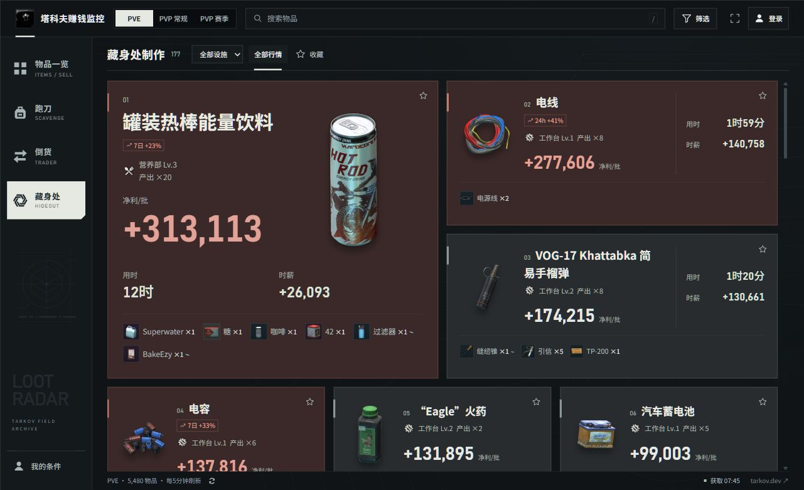
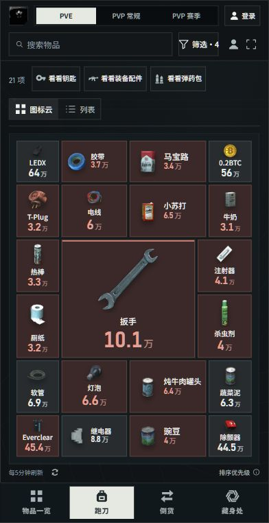
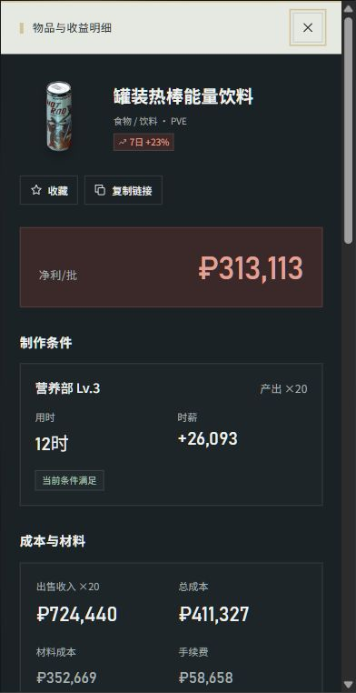
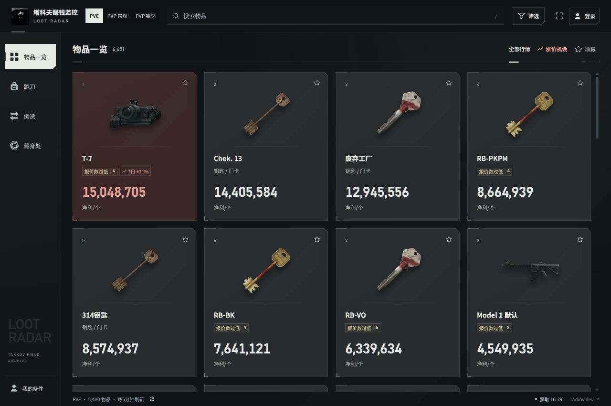
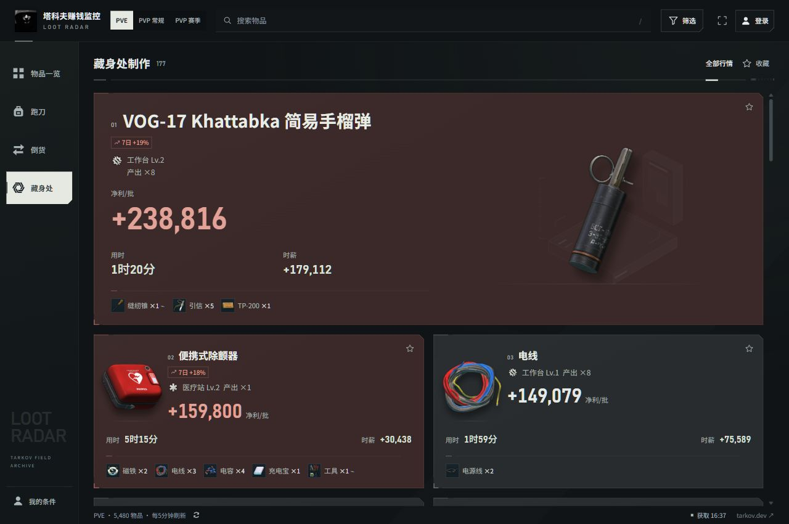
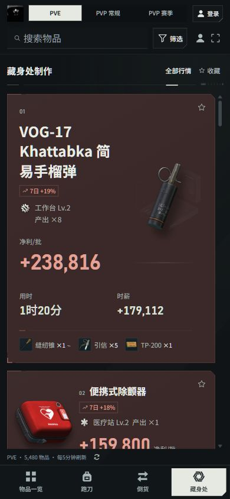
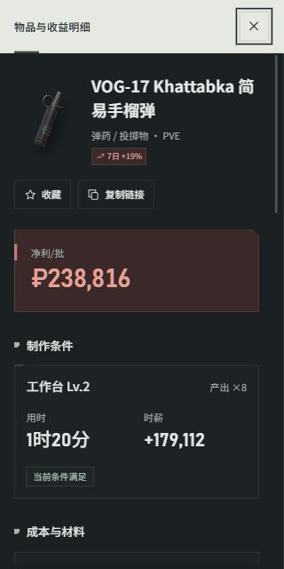
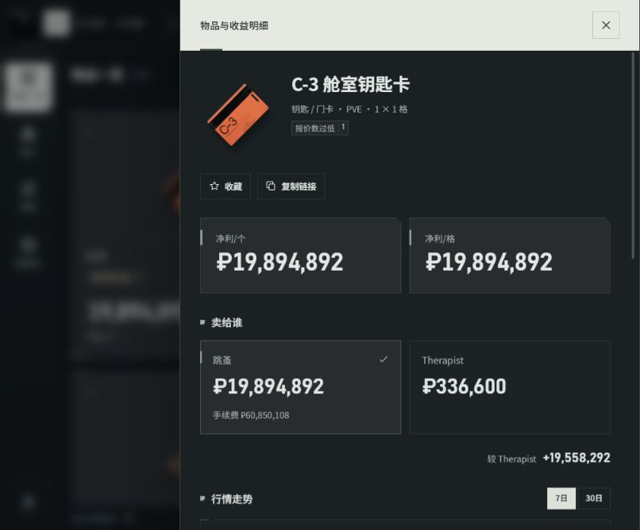

# 前端设计交接

此前全站视觉与比例优化的快照已推送至 `main`，提交为 `d4a70ca`。当前本地保留已确认的四页紧凑页头、深色卡片、制作工单构图和固定标准密度，移除列表卡片的明细按钮；按授权精简卡片次要指标与工具条，并将手动刷新移至页脚。最新一轮移除长期高值的视觉标记与武器预设 TAG，重排详情阅读顺序、恢复必要分组边框，调整制作主卡图文比例，并修复跑刀边界与手机页脚对齐，尚未推送。完整报价与成本信息保留在详情，真实行情、收益计算、账号、评论和后台沿用现有实现。

## 运行

使用 Node.js 24 或更高版本：

```sh
npm ci
npm run local
```

打开 [本地跑刀页](http://127.0.0.1:8787/?market=pve&view=run)。首次运行会从上游获取行情，需联网。源码不包含账号数据库、邮箱授权码、行情缓存；访客浏览不需要配置邮箱。

如果本机已有压缩产物，开发时设置 `CLIENT_BUNDLE=0` 再启动服务，可以直接编辑源码并刷新查看。PowerShell：

```powershell
$env:CLIENT_BUNDLE = "0"
npm run local
```

交付前运行：

```sh
npm test
node scripts/build-client.mjs
npm run build
```

`build-client.mjs` 生成 Node 服务使用的压缩资源。验证压缩版本时取消 `CLIENT_BUNDLE=0`，并重启本地服务。`npm run build` 检查保留的托管构建。

## 页面入口

| 文件 | 职责 |
| --- | --- |
| [app/index.html](../app/index.html) | 四个主页面、工具栏、筛选和条件面板 |
| [app/app.js](../app/app.js) | 实际数据渲染、搜索、卡片、详情、设置 |
| [app/style.css](../app/style.css) | 基础组件与响应式布局 |
| [app/terminal.css](../app/terminal.css) | 当前视觉覆盖层，最后加载 |
| [app/ui-motion.mjs](../app/ui-motion.mjs) | 导航切换、卡片重排、收藏与抽屉动效 |
| [app/quicklook.mjs](../app/quicklook.mjs) | 图标云排布、五档尺寸与屏幕边界 |
| [app/loot-priority.mjs](../app/loot-priority.mjs) | 跑刀排序与等级开关 |
| [app/accounts-ui.mjs](../app/accounts-ui.mjs)、[app/comments-ui.mjs](../app/comments-ui.mjs) | 账号与评论界面 |
| [app/accounts.css](../app/accounts.css)、[app/community.css](../app/community.css) | 账号与评论的视觉样式 |
| [app/admin.html](../app/admin.html)、[app/admin.css](../app/admin.css) | 后台入口、管理工作区与响应式样式 |
| [app/model.mjs](../app/model.mjs) | 金额、手续费、交易限制与行情标签 |
| [app/server.mjs](../app/server.mjs) | 完整本地服务与接口 |

页面使用原生 HTML、CSS 和 JavaScript。框架路由 `app/route.ts` 读取同一份 HTML；`prototype/` 是早期概念稿。修改真实入口，避免只做独立演示页。DOM 的 ID、`data-*` 属性与事件处理相连，重构组件时同步核对。

四个页签共用 `state.search`，切页签保留搜索词，各页其余筛选仍独立。搜索词只保存在本机，账号条件同步不清空当前输入；清空搜索会同时解除四页的关键词筛选。

## 设计方向

参考《明日方舟》的工业机能与冷淡气质，以石墨色外壳、深色卡片和骨白导航选中块建立明暗秩序。卡片保持整块深色底面；制作首项主卡与右侧两张卡片各占一半宽度，名称、设施和净利在左侧连续排列，放大的图片占右侧主体区域。直角与窄状态条统一组件，背景线稿降为低对比。

普通、短期涨价、亏损共用三组状态变量，普通卡、跑刀、制作和详情使用同一色号：

| 状态 | 底色 | 数字色 |
| --- | --- | --- |
| 普通 | `#282C2E` | `#E4E8E6` |
| 短期涨价 | `#3A2928` | `#E3A298` |
| 亏损 | `#23372E` | `#9EC8AD` |

长期高值与长期稳定不再显示金色底面、金色数字、TAG 或相应筛选入口及说明；普通状态统一使用石墨底，涨价红与亏损绿继续表示当前行情差异。武器预设仅移除 TAG，整枪估值方式与功能保留。名称、金额、说明通过字号区分，透明物品图使用统一容器与投影，详情图片容器无白色底块。详情恢复收益、渠道、成本等必要分组边框，行内不再叠加重复分界线。界面字体优先使用本机 Noto Sans SC，数字使用 Bahnschrift，均保留系统回退；当前未打包外部字体文件。跑刀导航改为与其他入口同尺度的背包图标。

界面固定夜间外观和标准网格密度，适配手机、平板、桌面与旁屏。旧缓存、账号同步和导入恢复仍可读取，但密度统一为 `standard`。卡片可点击、详情用抽屉；透明和模糊集中在少数覆盖层，数据区域使用稳定的哑光底面。

设计前研究了[《明日方舟》中文官网](https://ak.hypergryph.com/)、[官方国际站](https://www.arknights.global/)与[官方 Fankit](https://arknights.global/fankit)，并阅读了 [Anthropic frontend-design Skill](https://github.com/anthropics/skills/blob/main/skills/frontend-design/SKILL.md)。全站改版提取黑白大块、尺度差、网格与工业标记的构图语法，未使用《明日方舟》的角色、Logo 或其他 IP 图像；站内装饰线稿为原创，物品内容保持塔科夫语境。


### 全站紧凑页头

用户已确认按预览统一物品、跑刀、倒货和制作四页。保留顶栏品牌，宽度 ≤1150px 时仅显示 Logo；市场、搜索、筛选、全屏和账号集中在顶栏。取消独立 `commandbar` 大标题横幅，将 `h1` 与结果数量移入列表的 `context-toolbar`，与行情切换或跑刀工具同排。

宽度 ≤540px 时，仅将 `h1` 设为视觉隐藏，保留可访问标题和可见数量，由底部选中导航标识当前页。手机顶栏使用两条紧凑行：第一行保留市场与账号，第二行放搜索、筛选及条件、全屏入口。没有新增“更多”菜单或市场下拉，也未将品牌移入侧栏。

原 `sync-status` 移至页脚工具区，宽度 >700px 时显示，手机延续隐藏行为。手动刷新采用小图标，紧邻页脚“每5分钟刷新”文字右侧；顶栏不再重复提供刷新入口。临时提醒和已激活筛选仍按原条件出现，页脚不再提供密度切换。物品、倒货和藏身处工具条移除“重置”，倒货工具条移除“单次净利 ↓”；跑刀移除收藏筛选和手动重排，行情刷新后自动重排。

此前紧凑页头迭代在 770×668 视口下，将内容起点由约 205px 降至 117px，回收约 88px；该数值仅记录上轮比较，不作为本轮重新测量结果。

### 卡片构图与信息精简

按用户最新授权，物品卡移除最低价、与商人的价差比较和格子尺寸；倒货卡移除最低价与总成本；藏身处卡移除总成本与最低价。这些信息保留在详情。卡片继续保留物品名称与图片、状态和净利；制作卡另保留设施及等级、产量、用时、时薪和材料。材料显示前六项及余数，保留数量与工具标记，更多信息可进入详情。材料区自然换行，不再限制高度裁切。

制作页采用已确认的工业档案构图：首项主卡横向占据整行，名称、设施、净利、用时与时薪、材料沿左侧排列，右侧为大幅透明物品图和低对比工位背景；后续卡片统一两列，1600px 起三列，手机单列。金额按实际字符长度与容器宽度缩放。用时上方不加横线，材料区保留一条局部断开的细分界线并自然换行。物品页改为上方陈列图、下方名称与收益的卡片；倒货页保留图文、商人、材料三个区域，商人与材料之间保留细线。

所有列表卡片移除右下角“明细 / 详情”按钮，右上角保留收藏星标。整卡点击与键盘 Enter / 空格仍打开详情，收藏按钮独立响应。长名称最多两行，完整名称保留在提示中；负值、未知估值、未解锁状态和筛选逻辑沿用原实现。

此前“左侧首项主卡＋右侧两张横卡”的布局已由横向重点卡取代。三类状态色保持统一，材料继续留在制作卡片；完整报价、成本与其他交易细节进入详情查看，详情物品图透明。旧工单截图仅用于记录历史。

### 详情阅读顺序

详情按身份 → 收益 → 渠道或执行条件 → 成本材料 → 行情 → 相关路线与评论排列。玩家先确认物品与收益，再判断交易方式、限制和所需投入，随后查看行情依据。最低价、均价与报价数合并到行情区域，避免散落在收益和成本之间。必要组边框保留，标题与组内行不重复画线，以留白和字重维持连续阅读。

## 动效

- 导航使用骨白游标滑动并适配按钮尺寸，重复行情渲染不重新触发导航动画。
- 首次打开依次呈现导航、工具栏与行情内容；首次数据就绪后解除加载，后续行情更新不重播开场。
- 页面切换使用短距离遮罩擦入，工具栏与内容错开进入，页名随工具栏一起呈现；旧页面仅复制最多 12 个可见项目短暂淡出。
- 卡片重排采用 FLIP 位移和尺寸过渡，未变化项目保持静止，已有项目不反复淡入，新增项目轻量进入；远距离移动收敛为短位移。
- 详情与设置抽屉先呈现容器，再呈现身份、指标与内容；退出时内容收拢。关闭途中重开会取消原关闭任务，关闭完成后恢复原入口焦点。
- 收藏与取消收藏采用不同的短促图标反馈。系统“减少动态效果”动态生效，立即取消正在运行的动画，保留操作与状态变化。

动效集中于 [app/ui-motion.mjs](../app/ui-motion.mjs)，不接管行情、账号、条件或估值状态；不新增动画依赖。

## 已确认的功能

- 导航为物品一览、跑刀、倒货、藏身处；PVE、PVP 常规、PVP 赛季分别计算。保留账号、评论、条件、收藏与筛选。
- 物品一览按单件净利展示和排序；可执行的商人回收更优时采用商人金额并显示“卖 XX”。负差额展示实际数值。卡片不显示均价、最低价、与商人的价差比较和格子尺寸；详情保留这些信息、24小时均价和走势图。
- 倒货卡保留净利与交易条件，移除最低价和总成本；制作卡保留净利、设施、材料、用时、产量与时薪，移除总成本和最低价。完整报价、总成本、材料单价和费用保留在详情。总成本含手续费，利润只扣一次；商人或设施等级不足时隐藏对应路线。商人最高忠诚度用皇冠。
- 预设武器按对应默认整枪的跳蚤价格估算，不叠加配件收入；仅移除“武器预设”TAG，估值与功能保留。制作不计燃料，最终每批收益优先，时薪紧邻用时。
- 跑刀默认四类为交换用品、饮食、情报、医疗物品；浏览门槛为单格3万。搜索可查询低价值和其他类型物品。弹药箱属于容器，弹药包独立分类。
- 跑刀常见好物居中放大、次要物品外围收小，紧密排布，放不下的隐藏；保留列表切换，移除收藏筛选与手动重排入口，刷新行情后自动重排。图标云各尺寸统一使用透明物品图，只展示图片、名称、单格价值和行情底色。网格间距恢复为布局算法使用的 4px，消除底部逐行累计越界；手机页脚“排序优先级”靠右。当前组内权重为常见程度50%、价值40%、涨价10%，细则以排序模块为准。
- 钥匙、武器配件、弹药包预设是临时切换，再点当前预设恢复自定义筛选。“默认”位于筛选面板，首页没有恢复默认按钮。“无视跳蚤等级限制”默认勾选。
- 普通石墨底、短期涨价深红底、亏损深绿底，配套数字色在四页与详情中保持一致；冲突时亏损优先于短期涨价。长期高值与长期稳定的全部视觉标记、金底、TAG 和相关筛选入口及说明已移除。活动物品由开关控制，底色计算完成后再显示。
- 搜索框统一为“搜索物品”。排序说明只保留权重和“≥3万 / 格”。顶栏保留全屏，手动刷新改为页脚“每5分钟刷新”右侧的小图标，行情默认自动更新。物品、倒货和藏身处工具条不再显示重置。网格固定标准密度，无密度切换入口；没有“显示与工具”抽屉。
- 列表卡片右上角星标用于收藏，点击卡片其他区域打开详情。图标云继续使用整个物品块作为详情入口。
- 默认玩家、商人、设施和任务满进度，但可编辑；账号同步条件与筛选，评论每页5条。行情定期更新，有新行情时倒计时应用。

## 当前界面

下列截图用于记录最新的主卡比例、跑刀边界与详情阅读顺序，行情金额仅代表截图时刻；截图由最终视觉检查保存。







## 验收

上一轮完整信息恢复版已通过 `npm test`，共 **157 / 157** 项；`node scripts/build-client.mjs` 与 `npm run build` 两种构建均通过。该版手工核对四页，并检查 320、390、770、1280px 宽度：页面无横向溢出，制作材料自然换行，售价与总成本保持两列。整卡键盘打开详情、抽屉关闭、收藏往返、搜索与清空恢复、窄屏筛选面板正常；密度为标准，列表卡片没有明细按钮。以上记录属于恢复深色配色与工单布局之前的版本，不作为最新布局的验收结论。全部市场、账号与评论流程未逐项手工复测。

上一轮深色配色、工单布局与信息精简版已通过 **158 / 158** 项测试及两种构建。新增回归覆盖旧跑刀收藏筛选在本地与账号恢复时清除，并保留其他页收藏与跑刀类型条件。手工检查四页，以及 320、390、626、770、1280px 视口：页面无横向溢出；制作卡片只保留用时、时薪与材料等核心信息；物品/倒货卡片移除指定报价与成本。通过整卡 Enter 打开详情，确认售价、总成本、进货/材料成本、手续费、渠道比较和物品占格仍可查。页脚刷新按钮可完成请求并恢复可用状态，跑刀仍正常显示；实际应用行情时清空旧排布缓存，自动按新数据排布。指定重置、跑刀收藏筛选与手动重排入口均已移除。手机登录文字完整显示，制作辅助文字已增大。以上记录不作为本轮统一状态色、主卡与详情调整的验收结论；未逐项手工复测全部市场、账号与评论流程。

上一轮统一状态色、制作主卡与详情分层调整通过了脚本语法检查、客户端构建及 `npm run build`，未重复执行当时的完整测试。历史手工检查覆盖 1280px 制作页与物品页，以及 390px、320px 详情：大卡取消白色分段，物品图片透明，状态色统一，重复边线移除，窄屏金额完整，费用与材料内容保留，倒货工具条去除“单次净利 ↓”。该轮四状态配色和无边框详情已经被最新方案取代，以上结果仅为历史记录，不作为当前布局验收结论。

最新一轮三状态配色、详情重排、制作主卡比例与跑刀边界修复已通过 **158 / 158** 项测试、客户端构建及正式 `npm run build`。手工检查 1280px 桌面、390px 与 320px 窄屏：跑刀所有卡片均在容器内，手机排序说明靠右；长期高值与武器预设 TAG 已清除；制作与倒货详情顺序、必要分组边框、制作主卡图文尺度、材料明细及窄屏无横向溢出均已核对。倒货商人与材料之间保留细线，制作用时上方无分隔线。仍未逐项手工复测全部市场、账号与评论流程。美术目标是统一视觉语义、减少无效强调、明确阅读顺序；不将其评价为《明日方舟》同等美术完成度。独立图形语言、图像呈现与动效细节仍有后续提升空间。

此前全站动效已通过语法检查，以及关闭中重开、重复关闭、焦点恢复、动态减少动效和卡片重排稳定性的行为验证。

后续首项大卡放大版已通过脚本语法检查、客户端构建与正式构建，并核对 1280、390、320px 布局及金额边界；本次未重复执行上述完整测试。主卡图文比例以 `craft-scale-*` 截图为准。

详情滚动改由正文区域承担，标题固定，细滚动条位于右侧边框内并内缩 5px。打开、切换路线与行情更新的滚动位置处理统一到正文容器。相关赚钱路线增加 12px 左右内边距，负收益金额使用亏损绿色。已通过语法、客户端与正式构建检查，并验证正文滚动、路线切换与返回、关闭重开回顶部；示例见 [路线与滚动条](images/detail-routes-scroll-mobile.png)。

制作设施下拉框已移入制作页筛选面板，随“应用筛选”生效；取消后恢复已应用条件，已选设施显示为可单独清除的筛选标签。设施选项仅在打开面板时填充，行情刷新不会覆盖尚未应用的设施选择。“排序优先级”文本、按钮和说明弹窗已删除，排序计算保持不变。已通过脚本语法检查与正式构建，手工验证 390px 的应用、取消、标签清除及跑刀筛选隔离，以及 1280px 页面和设施字段显示；示例见 [制作设施筛选](images/craft-filters-mobile.png)。本次未重复运行完整测试。

发布前回归清单：检查四个页面与三个市场、搜索后清空恢复、预设往返、筛选默认、详情及走势图、条件保存、账号和评论入口；覆盖桌面与窄屏的点击、滚动、抽屉关闭和减少动效，以及缓存恢复、批次标色与图片复用。该清单不代表本轮已逐项完成手工检查。

前端改版沿用现有计算与接口，验收通过后再准备发布包。业务背景见 [产品说明](product-design.md)，玩家反馈见 [玩家视角评审](reviews/2026-10-22/README.md)。


## 2026-10-23 工业档案方案落地

已按确认方案将四个前台页面、详情、筛选、个人条件与账号弹层接入同一套视觉规则。原 Fence 网站 LOGO、藏身处标识及侧栏 LOOT RADAR 字标保留；导航不使用柜体插画。桌面侧栏精简，手机仍保留原固定底部导航及安全区。卡片采用短收口、断开细框与小切角，状态色沿用中性灰、涨价红、亏损绿；背景只保留低对比块面，制作重点卡使用原创工位图。

实现分为 `app/archive.css`、`app/archive-crafts.css`、`app/archive-details.css`，位于既有样式之后；资源已接入本地服务器、静态资源准备与带指纹客户端构建。`public/workshop-field.svg` 为工位背景。物品卡增加陈列样式类和金额长度变量，不改行情、排序、估值、账号或刷新逻辑。卡片焦点环位于内部，避免切角裁掉；切页克隆保留卡片样式。

跑刀继续使用原中心聚合云图、各级大小和原排序规则，保留图标云／列表、三组预设、筛选、搜索、点击详情及行情应用后自动重排；4px 间隙与10px内边距保持不变。未恢复收藏筛选、排序说明或手动重排。

本轮完整功能测试158/158通过。客户端构建与正式构建通过。浏览器检查320、390、880、1280、1600px：无横向溢出，金额未越界，云图所有卡片在容器内；已验证预设恢复、云图／列表切换、制作设施筛选入口、键盘打开详情及内部滚动布局。账号、评论的实际登录和提交未进行人工端到端测试，现有对应自动测试通过。









制作卡图片遮字修复：取消普通图超出容器的130%尺寸，明确图框内部网格轨道，图片按原比例完整适配；悬停仅轻微上移，并预留4px空间。保留大卡布局与原图片比例。320、390、880、1280、1600px下各30张已渲染卡片的图片边界与名称、设施、收益、用时及材料区域无交叠，悬停位移余量检查通过。客户端构建与正式构建通过；本次仅修改样式，未重复执行完整功能测试。

页脚最终文案已统一为“每5分钟刷新”和“同步 XX:XX”，删除市场名与物品数前缀。随后完成三名子代理分工评审及主代理独立复核，确认两项待修复问题：跑刀云图换搜索词保留旧滚动位置、腾讯云发布包漏掉工位 SVG。158项自动测试及两条构建均通过；详细证据、建议和验证边界见[本轮总评审](reviews/2026-10-23/README.md)。评审发现尚未改动实现。

后续按用户指令修复第1项：全局搜索词经 trim / 小写规范化后纳入云图 key，换词返回顶部；加载更多及同查询行情更新仍保留阅读位置。390×640实测：换词后scrollTop由1118.4变为0，40项加载到80项及刷新后仍保持1118.4；清空搜索恢复正常云图。相关14项测试、语法与两条构建通过。第2项发布资源遗漏由用户安排打包机器人解决，本次未修改发布脚本。

## 连续操作失去点击与滚动的修复

在本机浏览器复现：连续切页、开关详情后，卡片仍可见，但内容区中心的 `elementFromPoint` 返回外层 `market-stage`；此时没有打开的 dialog 或残留离场克隆。仅去掉裁切或克隆的 inert 不能解决问题。改为不对 `#monitor-panel` 整体执行位移动效，首屏及切页均由卡片分批入场，内容区不再丢失命中。导航、抽屉与离场克隆保留原动效和可访问性处理。

最终版本实测覆盖：桌面16轮跨四页切换、开关详情和键盘翻页；6次双击卡片与连续 Esc；9次快速切页；4次筛选/条件抽屉开关；390×780下6轮四页操作。均无残留模态或遮罩，内容区命中正常。鼠标滚轮实测使列表 scrollTop 从0变为668，键盘翻页同样正常，窄屏无横向溢出。


